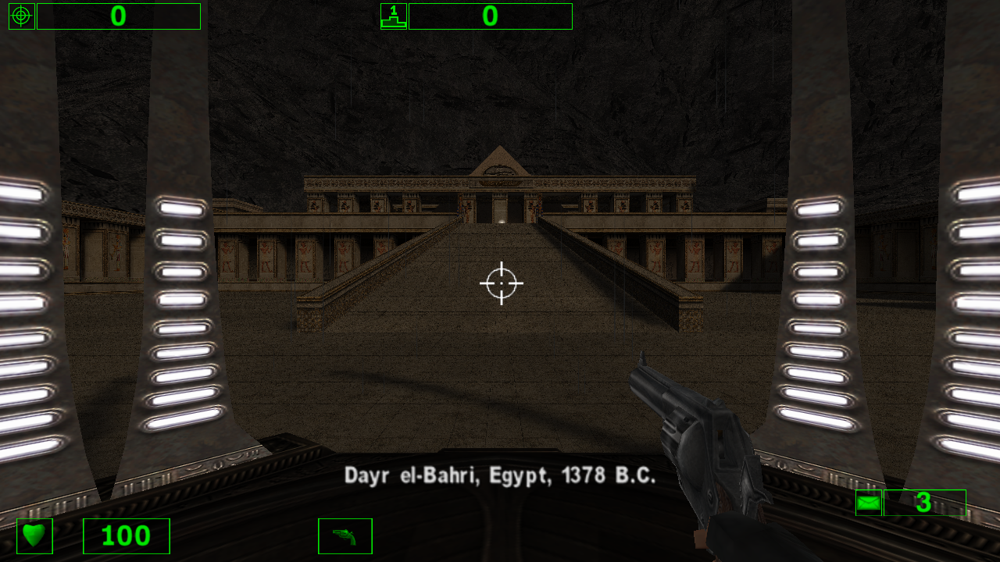
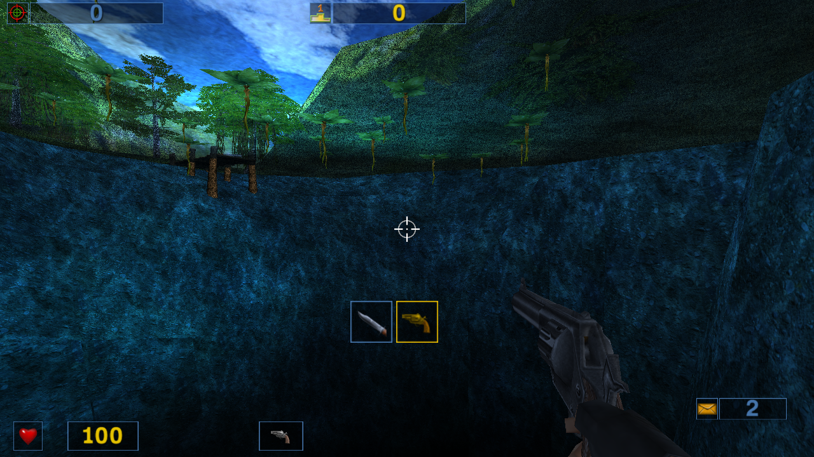

# Serious Sam PS4

**Experimental alpha:** [TFE 0.04 + TSE 0.02 release](https://github.com/NichlasEk/SeriousSamPS4/releases/tag/alpha-tfe-0.04-tse-0.02).
Download the PKG(s) and support-data ZIP, then follow [installation](docs/INSTALL-ALPHA.md).
Original game files are required. These exact builds are emulator-tested; physical PS4
and USB validation remain pending. See [third-party credits](docs/THIRD-PARTY.md).

PS4 port workspace for the classic Serious Sam games. Croteam's original [Serious Engine 1.10](https://github.com/Croteam-official/Serious-Engine) source is pinned in `engine/`. The Linux/SDL2/[Vulkan fork](https://github.com/tx00100xt/SeriousSamClassic-VK) used for port work is pinned in `engine-vk/`. Both are Git submodules.

Clone with `git clone --recurse-submodules https://github.com/NichlasEk/SeriousSamPS4.git`, or run `git submodule update --init` after a regular clone.

The upstream repository includes the `SE1_10.gro` resource archive for running the engine without the original game data. Original First Encounter and Second Encounter game resources are separate. Put locally supplied game data under `media/`; that directory is ignored by Git.

For MODE2/2352 BIN/CUE images named `Serious Sam - The First Encounter (USA)` and `Serious Sam - The Second Encounter (USA)`, run `python3 scripts/extract_discs.py`. It leaves the original files intact, converts them to `media/iso/{tfe,tse}.iso`, and extracts them under `media/game/{tfe,tse}/`.

The original game archives are in `media/game/tfe/Install/*.gro` and `media/game/tse/Install/*.gro`. The port will stage the needed archives for each game separately. All disc images, converted ISOs, and extracted files stay local.

**First Encounter 0.02 is confirmed running on a physical PS4:** the user reports smooth gameplay and slower cinematics. The next First Encounter build adds touchpad quicksave and hold-L3 walking. **Second Encounter now cross-builds and runs through the same PS4 Vulkan stack in shadPS4**, with a separate title, profile and local package. Its physical PS4 test is pending.

## Build and run the initial PS4 client

With the local OpenOrbis SDK and the Doom 3 native graphics archives available:

```sh
bash scripts/build-ps4.sh tfe
python3 scripts/run-ps4.py --game tfe --seconds 180
bash scripts/build-ps4.sh tse
python3 scripts/run-ps4.py --game tse --seconds 180
```

The builds produce `build/runtime-tfe/eboot.bin` and `build/runtime-tse/eboot.bin`. The runner uses separate shadPS4 profiles and atomically allocated Xvfb displays, captures `artifacts/ps4/emulator.png` or `artifacts/ps4-tse/emulator.png`, records logs and stops after the requested duration.

To build a small package with separate game data, see
[external data installation and validation](docs/EXTERNAL-DATA.md).

```sh
bash scripts/build-ps4.sh tfe
python3 scripts/package-ps4.py --game tfe
python3 scripts/verify-ps4-package.py --game tfe
bash scripts/build-ps4.sh tse
python3 scripts/package-ps4.py --game tse
python3 scripts/verify-ps4-package.py --game tse
```

| Game | Package in `dist/` | Separate data folder in `dist/external-data/` |
| --- | --- | --- |
| First Encounter | `SeriousSam-TFE-PS4-Alpha-0.04-external.pkg` | `serioussam-game/` |
| Second Encounter | `SeriousSam-TSE-PS4-Alpha-0.02-external.pkg` | `serioussamse-game/` |

Copy the whole data folder to PS4 `/data/` or the USB root. HDD takes priority,
then USB slots 0–7. Saves/logs remain at `/data/serioussam` and
`/data/serioussamse`. Both titles can coexist. Previous bundled local packages
are preserved for rollback. Physical validation of these new builds is pending.

See [port status](docs/PORT_STATUS.md) for dependencies, current evidence and remaining work.

## shadPS4 screenshots

Captured from the exact release executables with external game data. These are
emulator captures, not photos of a physical PS4. No image retouching was applied.

**First Encounter 0.04 — Hatshepsut**



**Second Encounter 0.02 — Palenque**



## Cover icons

Separate generated artwork is included for each encounter. Package-ready icons:
[TFE](assets/icon0-tfe.png) · [TSE](assets/icon0-tse.png). Originals are under
`assets/artwork/`; the [exact prompts](assets/icon-prompts.json) record the
built-in image generation workflow.
