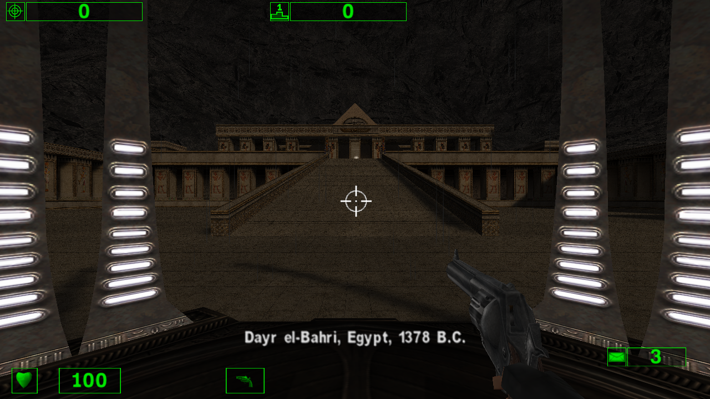
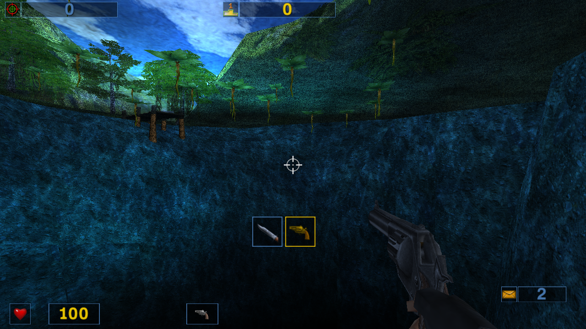

First public experimental release of the classic **Serious Sam: The First
Encounter (0.04)** and **The Second Encounter (0.02)** PS4 ports.

- Separate small PKGs for both games; both can coexist.
- External game data: **internal HDD first, USB fallback** (slots 0–7).
- Saves, settings and logs stay on the internal drive.
- No commercial game data included. You need your own classic original games.

Download the PKG(s), `SeriousSam-PS4-support-data.zip` and **INSTALL.md**.
Add your own campaign files to the matching support-data folder and copy it to
`/data/` on the PS4 or the USB root. See INSTALL.md for the exact file list.

**Validation:** both first campaign levels loaded and created quicksaves in
shadPS4; package extraction and integrity checks passed. These exact builds and
USB fallback are **not yet verified on a physical PS4**. Expect alpha limitations;
this is not a complete-playthrough or firmware-compatibility claim.

Source/build/relink material and SHA-256 checksums are attached. See
**THIRD-PARTY.md** for credits and dependency terms, including the undeclared
upstream license of the linked libjbc USB helper.

Please report the game/version, firmware, storage type and symptoms in Issues.

### Screenshots — shadPS4 emulator

These captures show the exact release executables loading the first campaign
levels with external game data. They are not physical PS4 screenshots.

**The First Encounter — Hatshepsut**

**The Second Encounter — Palenque**

